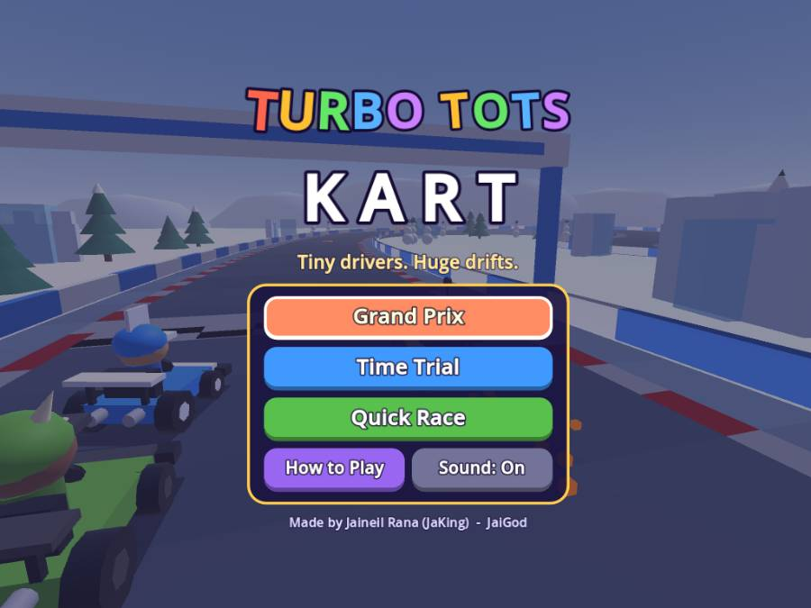
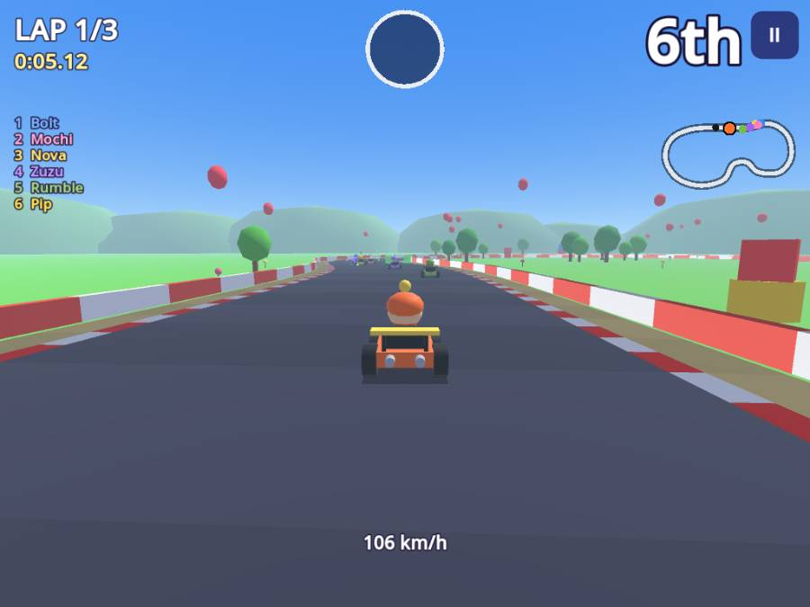
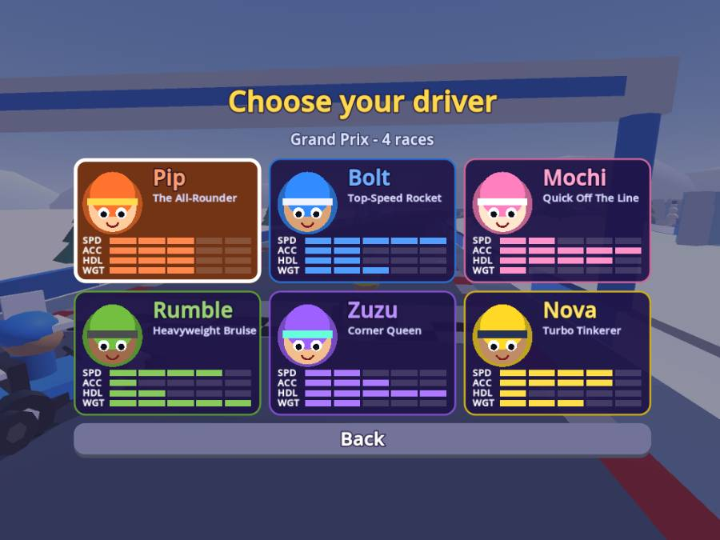
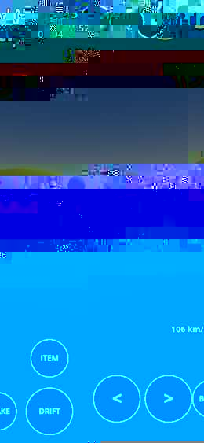

<div align="center">

# 🏎️ Turbo Tots Kart

### Tiny drivers. Huge drifts.

A low-poly **3D kart racer** made in **Godot 4**, with 4 tracks, 6 drivers, drift boosts, 6 power-ups, AI rivals, a Grand Prix and ghost time trials. It plays in your browser on desktop and phone.

[](https://jaigod.github.io/turbo-tots-kart/play/)

[](https://jaigod.github.io/turbo-tots-kart/)
[](https://godotengine.org)
[](project.godot)
[](https://github.com/JaiGod/turbo-tots-kart/actions/workflows/pages.yml)
[](LICENSE)

</div>

---

## 📸 Screenshots

| Title screen | Racing on Sunny Sandbox |
|:---:|:---:|
|  |  |
| **Choose your driver** | **Phone (touch controls)** |
|  |  |

## ✨ Features

- 🌀 **Drift boosts**: hold drift through a corner to charge **blue → orange → purple** sparks, then let go for a turbo. Hit the gas as "1" fades for a **Rocket Start**.
- 🏆 **Grand Prix**: 4 races, points 10-8-6-4-2-1, standings after each race and a trophy ceremony for the top 3.
- 👻 **Time Trial with ghost**: your best run is recorded and saved, and next time a see-through ghost kart races you.
- ⚡ **Quick Race** on any track with any driver.
- 🤖 **5 AI rivals** that follow racing lines, drift, use items and rubber-band gently, so races stay close.
- 🎁 **6 original power-ups** from rainbow **?** cubes:

  | Power-up | Effect |
  |---|---|
  | 🚀 Rocket Pop | Instant turbo blast |
  | 🔵 Bounce Ball | Fires forward and ricochets off the walls |
  | 🟢 Goo Puddle | Drop it behind you. Splat! |
  | 🐝 Buzz Bee | Homes in on the racer just ahead |
  | 🫧 Bubble Shield | Blocks the next hit for 10 seconds |
  | 🧲 Magnet Mitten | Locks on and tows you up the track |

- 🗺️ **4 tracks**: **Sunny Sandbox** (park), **Candy Canyon** (hills), **Frosty Fort** (snow) and **Starlight Speedway** (a night figure-eight with a bridge). Each has boost pads and item rows.
- 🧒 **6 drivers** with different stats (speed / accel / handling / weight): **Pip, Bolt, Mochi, Rumble, Zuzu, Nova**.
- 🗺️ HUD with a minimap, live standings, item roulette, drift meter, speedometer and place.
- 📱 **Touch controls** with multi-touch buttons, in portrait and landscape.
- 🔊 Procedural sound effects with a mute toggle. Records, ghosts, trophies and settings are saved.
- 🎨 **Everything is made in code**: karts, drivers, tracks, scenery, icons and sounds. There are no image or audio files.

## 🎮 Controls

| Action | Keyboard | Gamepad | Touch |
|---|---|---|---|
| Gas | `W` / `↑` | RT / A | automatic |
| Brake / reverse | `S` / `↓` | LT / B | BRAKE |
| Steer | `A` `D` / `←` `→` | left stick / d-pad | `<` `>` |
| Drift | `Space` / `Shift` / `K` | RB | DRIFT (hold) |
| Use item | `E` / `J` / `Ctrl` | X / LB | ITEM |
| Pause | `Esc` / `P` | Start | II |
| Mute | `M` | | Sound button |

## 🛠️ Tech stack

- **Godot 4.3** with GDScript and the **Compatibility (OpenGL / WebGL 2) renderer**, so it runs in every browser
- **Web export with threads off**, so it works on GitHub Pages without COOP/COEP headers
- **GitHub Actions** with `barichello/godot-ci:4.3`: headless smoke test, then Web export, then deploy to Pages
- Tracks are closed **Catmull-Rom splines** turned into road, kerb, wall and ground meshes with `SurfaceTool`
- UI is built entirely in code (Controls, StyleBoxFlat, custom `_draw()` for icons, minimap and touch pad)
- Sound effects are synthesized into `AudioStreamWAV` buffers at startup

## 📁 Project structure

```
turbo-tots-kart/
├── project.godot          # Compatibility renderer, 1152x648 canvas_items stretch
├── main.tscn              # single root node -> scripts/main.gd
├── export_presets.cfg     # Web preset (threads off)
├── scripts/
│   ├── main.gd            # game flow: title, GP, time trial, quick race, pause, saving
│   ├── race.gd            # race manager: grid, AI, items, laps, places, ghost, camera
│   ├── kart.gd            # kart physics, drifting, boosts, hits, low-poly model
│   ├── track.gd           # spline track mesh builder + themed scenery
│   ├── hud.gd             # HUD, minimap, item roulette, touch controls
│   ├── menus.gd           # every menu screen + confetti
│   ├── sfx.gd             # procedural sound effects
│   └── data.gd            # drivers, tracks, power-ups, GP rules
├── tests/smoke_test.gd    # headless bot plays every track, every item, TT + full GP
├── web/index.html         # landing page (game is served at /play/)
├── docs/screenshots/      # README images
└── .github/workflows/pages.yml
```

Source folders: [`scripts/`](scripts) · [`tests/`](tests) · [`web/`](web) · [`.github/workflows/`](.github/workflows)

## 🚀 Run locally

1. Install [Godot 4.3](https://godotengine.org/download/archive/4.3-stable/) and open `project.godot`, then press **F5**.
2. Run the headless smoke test:
   ```bash
   godot --headless --path . --import
   godot --headless --path . -s res://tests/smoke_test.gd   # prints "SMOKE OK"
   ```
3. Build the web version (needs the 4.3 export templates):
   ```bash
   mkdir -p site/play
   godot --headless --path . --export-release "Web" site/play/index.html
   cp web/index.html site/ && cp -r docs/screenshots site/screenshots
   cd site && python3 -m http.server 8000      # open http://localhost:8000
   ```

## 📓 Development log

- **Concept.** I wanted an original, kid-friendly kart racer with "tiny tots" drivers and chunky low-poly karts, plus original power-ups (Rocket Pop, Bounce Ball, Goo Puddle, Buzz Bee, Bubble Shield, Magnet Mitten). No characters, items or names are borrowed from other games.
- **No art files.** Everything is built from primitive meshes and spline geometry at runtime. That keeps the repo tiny (about 120 KB of code), and each track theme only needs a few colours in `data.gd`.
- **Tracks as splines.** Each track is a list of control points `[x, z, height]`. A closed Catmull-Rom curve is sampled about every 2 m, and the road, kerbs, walls and lap progress all come from those samples. Starlight Speedway is generated as a figure-eight (a Lissajous curve) with height, so it crosses itself over a bridge.
- **Arcade physics, not rigid bodies.** The karts use a custom kinematic model with grip, drift slip and wall constraints against the spline. That makes them predictable, cheap on phones and easy for the AI to drive.
- **Drift tuning.** There are three charge levels (0.8 s / 1.7 s / 2.7 s) with blue, orange and purple sparks and longer boosts. Small drifts help a little; long drifts are worth committing to.
- **AI.** Rivals aim at a look-ahead point on the racing line, drift through sharp corners, use items with simple rules (turbos on straights, balls and bees when someone is just ahead, goo when someone is right behind) and get a gentle rubber-band, so the pack stays close without cheating badly.
- **Ghosts.** The time trial records position and heading every few frames into a `PackedFloat32Array` and saves it to `user://`. On the next run a translucent ghost kart replays it.
- **Testing.** `tests/smoke_test.gd` drives the game headlessly. A bot finishes a race on all 4 tracks, fires all 6 power-ups, pauses and resumes, runs two time trials (record, then ghost) and completes a full Grand Prix to the trophy screen. CI runs it before every deploy.
- **Bug fix: invisible menus on the web.** The first web build showed the 3D scene but no menus, and the minimap was stuck in the corner. The UI controls used `set_anchors_preset(FULL_RECT)`, which keeps the current (zero) size, so the menu ScrollContainer was 0 px tall and clipped everything. Switching to `set_anchors_and_offsets_preset` fixed every screen.
- **Bug fix: squashed title.** The "TURBO TOTS" letters are separate animated Labels in an HBox. With autowrap on they shrank to zero width and stacked on top of each other, so I turned autowrap off for those letters.
- **Web build.** It uses the Compatibility renderer and threads off, so it runs on plain GitHub Pages. The landing page lives at `/` and the game at `/play/`.
- **Beta tested on the live site ✅ (2026-11-05)**: /play/ boots past the loading bar, title, driver select and a Grand Prix race on Sunny Sandbox run with keyboard input, pause works, and there are 0 console errors. The title, driver and race screenshots were captured from the live Pages build.

## 🔗 Links

- ▶ **Play:** https://jaigod.github.io/turbo-tots-kart/play/
- 🏠 **Landing page:** https://jaigod.github.io/turbo-tots-kart/
- 🧰 **Builds / CI:** [GitHub Actions](https://github.com/JaiGod/turbo-tots-kart/actions)
- 🏢 **More games:** [JaiGod on GitHub](https://github.com/JaiGod)
- 🎮 **Related JaiGod games:** [Circuit Siege](https://github.com/JaiGod/circuit-siege) · [Cloud Climb 3D](https://github.com/JaiGod/cloud-climb-3d) · [Isle of Embers](https://github.com/JaiGod/isle-of-embers) · [Voltline](https://github.com/JaiGod/voltline)

---

<div align="center">

Made by Jaineil Rana (JaKing) · part of [JaiGod](https://github.com/JaiGod)

</div>
